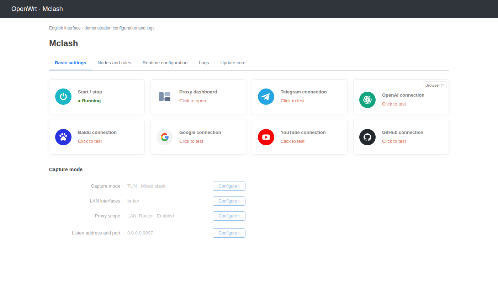
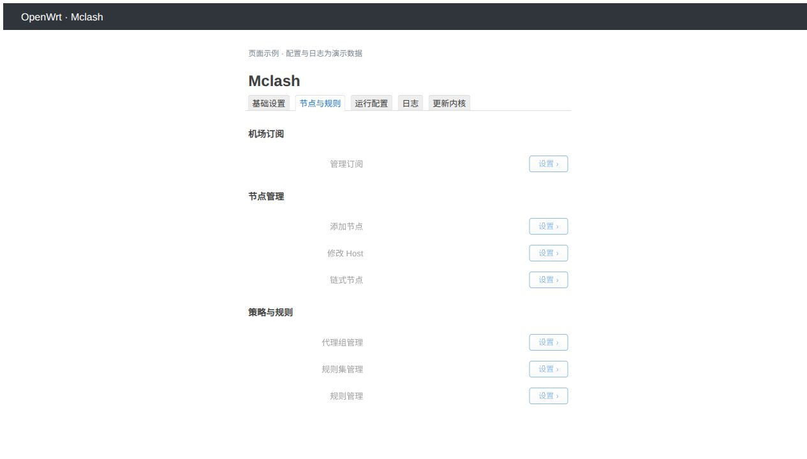
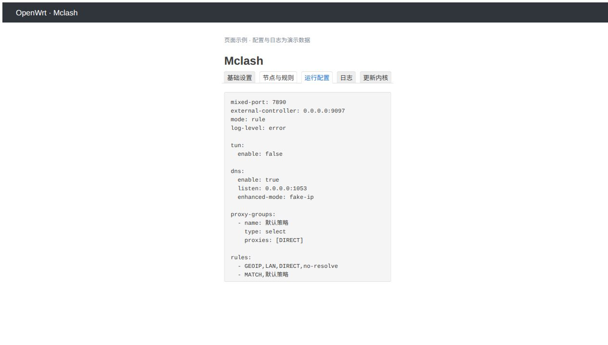
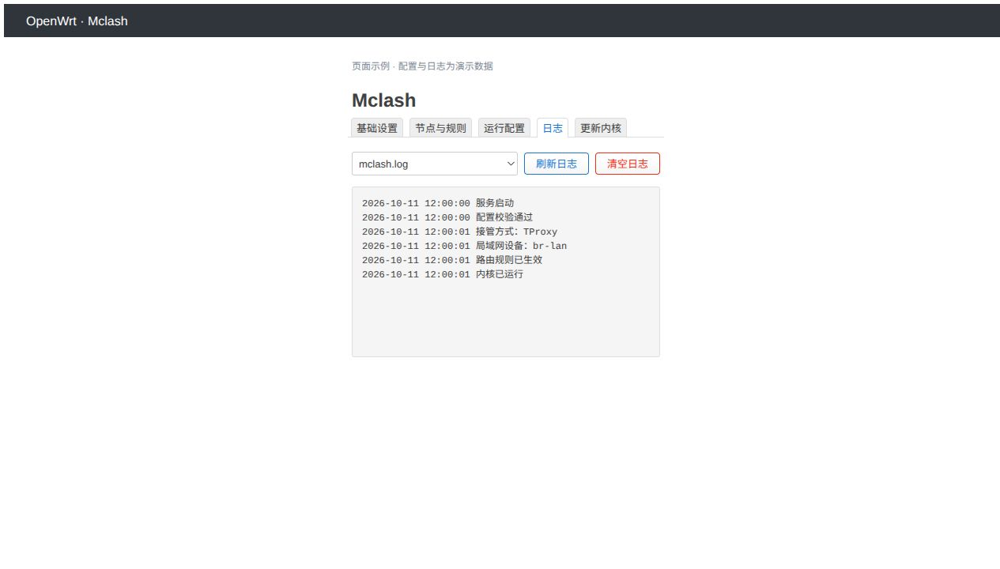
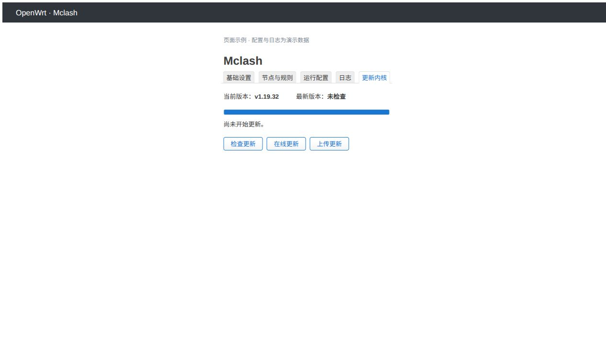

# luci-app-mclash

面向 OpenWrt 的 Mihomo LuCI 插件，提供代理接管、订阅与节点管理、配置覆写、运行日志和内核更新。代理面板使用 Zashboard，点击卡片在新窗口打开。

## 功能与页面

| 页面 | 功能 |
| --- | --- |
| 基础设置 | 点击启停、代理面板、站点连通性与出口 IP 检测；TUN／TProxy、局域网设备、代理范围与访问控制、控制接口 |
| 节点与规则 | 机场订阅、添加节点、修改 Host、前置链式节点、代理组、规则集和规则管理 |
| 运行配置 | 只读查看 YAML，进入页面自动刷新，长行横向滚动 |
| 日志 | 查看、刷新和清空服务、内核及更新日志，自动限制文件大小 |
| 更新内核 | 检查更新、在线更新、上传更新；校验失败保留原内核 |

配置修改前须停止服务。内核更新可在运行时进行：下载和校验后停服替换，成功恢复运行，失败回滚；停止状态更新后保持停止。

## 页面截图

以下为界面示例，配置与日志内容使用演示数据。实际布局随 LuCI 主题和屏幕宽度调整。

### 基础设置



### 节点与规则



### 运行配置



### 日志



### 更新内核



## 适用环境

需要 LuCI 与 firewall4／nftables，不支持 fw3／iptables。插件使用 JS 和 shell，软件包架构为 `all`／`noarch`；Mihomo 内核需要匹配路由器 CPU 架构，安装包不包含内核。

APK 和 IPK 不能互换，安装时按设备实际包管理器选择，并确保当前固件的软件源可提供插件依赖，包括 `kmod-tun` 和 `kmod-nft-tproxy`。首次使用可在「更新内核」中在线安装，或上传 [Mihomo 官方发布页](https://github.com/MetaCubeX/mihomo/releases) 中对应架构的文件。

插件内置 [MetaCubeX/meta-rules-dat](https://github.com/MetaCubeX/meta-rules-dat) 的 `GeoIP.dat` 和 `GeoSite.dat`，安装到 `/etc/mclash/`，首次配置校验无需下载这两个数据库。数据库仍按配置自动更新，升级插件时保留已更新的文件；自定义远程规则集仍需单独准备。从 v1.0.3 开始，发布安装包包含这两个数据库。

## 编译进 OpenWrt 固件

先准备与目标设备匹配的 OpenWrt／ImmortalWrt 源码及 Linux 构建环境。基础构建步骤可参考 [OpenWrt 官方说明](https://github.com/openwrt/openwrt/blob/main/README.md)。在固件源码根目录执行：

```sh
./scripts/feeds update -a
./scripts/feeds install -a

mclash_source="$(mktemp -d)"
git clone --depth 1 https://github.com/liuyi-htu/luci-app-mclash.git "$mclash_source"
mkdir -p package/luci-app-mclash
cp -a "$mclash_source/luci-app-mclash/." package/luci-app-mclash/

make menuconfig
```

复制的是仓库内的 **`luci-app-mclash/` 软件包目录**。在 `menuconfig` 中选择设备目标，进入 **LuCI → Applications → luci-app-mclash**（也可按 `/` 搜索包名）。选为 `<*>` 编译进固件，选为 `<M>` 生成单独安装包。

编译固件：

```sh
make defconfig
make -j"$(nproc)"
```

只编译插件：

```sh
make defconfig
make package/luci-app-mclash/compile V=s -j"$(nproc)"
```

固件位于 `bin/targets/`，插件包通常位于 `bin/packages/`。首次编译会构建依赖；出错时可用 `-j1 V=s` 查看具体错误。若已经安装了 feeds 中的同名包，请先移除重复的软件包来源。

## 使用 SDK 构建安装包

在 Linux x86_64 上准备 OpenWrt SDK 所需构建依赖，以及 Node.js、Python 3、BusyBox、curl、rsync、zstd：

```sh
git clone https://github.com/liuyi-htu/luci-app-mclash.git
cd luci-app-mclash

./build-openwrt.sh arm64
# 或
./build-openwrt.sh x86_64
# 两种一起构建：./build-openwrt.sh all
```

脚本下载并校验固定 SDK：`arm64` 使用 ImmortalWrt 25.12.1 filogic SDK，生成 APK；`x86_64` 使用 ImmortalWrt 24.10.4 SDK，生成 IPK。这两个选项表示构建所用 SDK，插件本身不含对应架构的 Mihomo 内核。其他固件版本建议使用其匹配 SDK 或固件源码编译。

生成的安装包及同名 `.sha256` 文件位于 `dist/`，验证记录位于 `.build-logs/`，缓存位于 `.build-cache/`。默认版本为 `1.0.9`，构建号为 `1`。

| 环境变量 | 用途 |
| --- | --- |
| `APP_VERSION`、`BUILD_NUMBER` | 覆盖 `VERSION` 中的版本与构建号 |
| `MCLASH_OPENWRT_CACHE` | 指定 SDK 与下载缓存目录 |
| `MCLASH_SDK_DIR` | 使用已有的、与目标固件匹配的可写 SDK |

源码已包含编译后的配置处理 JS，正常打包无需 Dart。修改 `overrides/` 后，先安装符合其 `pubspec.yaml` 要求的 Dart，再运行 `./build-overrides.sh` 生成配置模块，然后重新打包。

## 直接安装 APK／IPK

从 [GitHub Releases](https://github.com/liuyi-htu/luci-app-mclash/releases/latest) 下载与设备包管理器匹配的安装包及同名 `.sha256` 文件，即可直接安装，无需编译固件。也可由上述 SDK 或固件编译步骤生成安装包。以下以 `1.0.9-r1` 为例，文件名和路由器地址请替换为实际值；下载的文件请放入 `dist/`，或调整上传命令中的本地路径。

当前发布版本为 `v1.0.9`（安装包 `1.0.9-r1`），DNS 管理读取最新运行配置，并隐藏由接管和代理范围控制的字段；编辑弹窗取消后返回上一级管理列表。保留六站延迟检测及内置 GeoIP／GeoSite 数据库。

- [下载 APK](https://github.com/liuyi-htu/luci-app-mclash/releases/download/v1.0.9/luci-app-mclash-1.0.9-r1.apk) · [APK 校验文件](https://github.com/liuyi-htu/luci-app-mclash/releases/download/v1.0.9/luci-app-mclash-1.0.9-r1.apk.sha256)
- [下载 IPK](https://github.com/liuyi-htu/luci-app-mclash/releases/download/v1.0.9/luci-app-mclash_1.0.9-r1_all.ipk) · [IPK 校验文件](https://github.com/liuyi-htu/luci-app-mclash/releases/download/v1.0.9/luci-app-mclash_1.0.9-r1_all.ipk.sha256)

### APK 设备

电脑上传安装包与校验文件：

```sh
scp -O dist/luci-app-mclash-1.0.9-r1.apk dist/luci-app-mclash-1.0.9-r1.apk.sha256 root@192.168.1.1:/tmp/
```

登录路由器后执行：

```sh
cd /tmp
sha256sum -c luci-app-mclash-1.0.9-r1.apk.sha256
apk update
apk add --allow-untrusted /tmp/luci-app-mclash-1.0.9-r1.apk
/etc/init.d/rpcd restart
```

### IPK 设备

电脑上传安装包与校验文件：

```sh
scp -O dist/luci-app-mclash_1.0.9-r1_all.ipk dist/luci-app-mclash_1.0.9-r1_all.ipk.sha256 root@192.168.1.1:/tmp/
```

登录路由器后执行：

```sh
cd /tmp
sha256sum -c luci-app-mclash_1.0.9-r1_all.ipk.sha256
opkg update
opkg install /tmp/luci-app-mclash_1.0.9-r1_all.ipk
/etc/init.d/rpcd restart
```

校验须通过后再安装。也可通过 LuCI 的软件包页面上传安装包。安装完成后强制刷新浏览器，打开 **服务 → Mclash**。

## 首次使用

1. 在「更新内核」安装匹配设备架构的 Mihomo。
2. 在「节点与规则」添加机场订阅或节点，设置代理组与规则。
3. 在「基础设置」选择接管方式、局域网设备和代理范围。默认关闭自动接管。
4. 点击启停卡片启动服务；需要选择节点时点击代理面板卡片。

运行配置保存在 `/etc/mclash/config.yaml`，默认控制接口为 `0.0.0.0:9097`，可在基础设置中调整。详细接管、DNS、日志与卸载说明见 [使用说明](luci-app-mclash/README.md)。

## 源码结构

```text
luci-app-mclash/
├── VERSION                 # 版本与构建号
├── build-openwrt.sh         # SDK 构建入口
├── build-overrides.sh       # 配置处理模块编译入口
├── overrides/              # Dart 配置处理源码、默认 YAML 与锁定依赖
├── luci-app-mclash/         # 标准 LuCI 软件包目录
│   ├── Makefile
│   ├── htdocs/             # 页面、配置模块、图标与 Zashboard
│   ├── root/               # 服务、辅助脚本、配置与 ACL
│   └── tests/              # 验证脚本
└── docs/screenshots/        # 页面截图
```

开发验证见 [测试说明](luci-app-mclash/tests/README.md)，配置模块见 [模块说明](overrides/README.md)。许可与第三方署名见 [LICENSE](luci-app-mclash/LICENSE) 和 [NOTICE](luci-app-mclash/NOTICE)。
